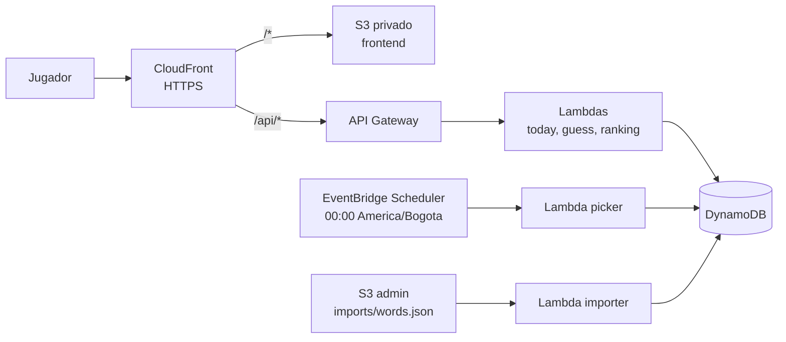

# Parlache del día

Un juego web diario de palabras colombianas. Cada día hay una palabra de 5 letras sacada del habla colombiana; tienes 6 intentos para adivinarla y, después de cada uno, el color de las casillas te dice qué tan cerca estás. Al terminar, el juego revela la palabra con su significado, un ejemplo de uso y la región donde se dice.

*Parlache* es el argot urbano de Medellín, de donde viene el nombre y la ambientación visual: las montañas del Valle de Aburrá al amanecer.

Proyecto Final – Proyecto Cloud Integral · Cloud Computing · UdeA 2026.

## Cómo se juega

- La palabra tiene **5 letras** y hay **6 intentos**. Hay una palabra nueva cada día a las 12 de la noche, hora de Colombia.
- **Verde**: la letra está en su lugar. **Amarillo**: está en la palabra, pero en otro lugar. **Gris**: no está.
- Las tildes no cuentan; la **Ñ** sí.
- Cada jugador tiene un alias anónimo (por ejemplo, `Chontaduro-482`), una racha de días ganados y aparece en el ranking del día y en el de rachas. No hay cuentas ni datos personales.
- Hay modo de alto contraste y el juego funciona con teclado físico, teclado en pantalla y lectores de pantalla.

## Cómo funciona

Todo corre sobre AWS, sin servidores que administrar. La palabra del día vive solo en el backend y no sale de allí hasta que la partida termina; el navegador pinta los colores con lo que responde el servidor.



| Capa | Tecnología |
|---|---|
| Frontend | HTML, CSS y JavaScript puro (módulos ES), sin build, sin librerías y con política CSP estricta |
| API | API Gateway HTTP API con límites de tasa por ruta, en el mismo dominio que el frontend |
| Lógica | 5 funciones Lambda en Python 3.12 (arm64), solo biblioteca estándar y `boto3` |
| Datos | 5 tablas DynamoDB bajo demanda, con transacciones y TTL |
| Automatización | EventBridge Scheduler con cola de mensajes fallidos (SQS) |
| Infraestructura | Terraform, región `us-east-1`, un rol IAM por función |

## Estructura

```
backend/    Lambdas en Python 3.12 y sus pruebas
frontend/   HTML + CSS + JS puro, sin build
infra/      Terraform (us-east-1)
loadtest/   Script de carga con k6
scripts/    Despliegue del frontend, importación de palabras y servidor local
tests/      Pruebas de la lógica del frontend
docs/       Decisiones, palabras pendientes, diagrama y capturas
```

## Requisitos previos

AWS CLI v2 con credenciales de trabajo (SSO o usuario IAM con MFA, nunca el usuario raíz), Terraform ≥ 1.6, Python 3.12, Node.js ≥ 20 y Git.

## Jugar en tu computador, sin AWS

```bash
python3 scripts/dev_server.py        # http://127.0.0.1:8000
```

Sirve el frontend y responde `/api/*` con la misma lógica de las Lambdas sobre un almacén en memoria. Los datos se pierden al reiniciar.

## Pruebas

```bash
pip install -r backend/requirements-dev.txt
pytest backend/tests                          # backend
node --test "tests/frontend/*.test.mjs"       # lógica del frontend
```

## Despliegue

```bash
cd infra/terraform
cp terraform.tfvars.example terraform.tfvars   # editar alert_email
terraform init
terraform fmt && terraform validate
terraform plan
terraform apply

cd ../..
./scripts/import-words.sh      # sube las palabras al bucket admin; el importer las carga
./scripts/deploy-frontend.sh   # sube el frontend e invalida la caché de CloudFront
```

La dirección del juego es el dominio `*.cloudfront.net` que muestra `terraform output cloudfront_domain`.
